# Від чистого ноутбука до готового НРК

**Вихідна ситуація:** чистий ноутбук з Windows 10/11, новий MikroTik і сервер
(Ubuntu або Debian), на якому ще нічого немає, але відома його публічна адреса.
Нижче — увесь шлях на прикладі нового НРК `nrk-001`.

Скріншоти знімає скрипт [docs/tools/screens.py](tools/screens.py) на тимчасовій
копії репозиторію. Сервера там немає, тому результат роботи з сервером на
скріншотах імітується: видно, як виглядає інтерфейс, а не справжнє розгортання.

## Коротко

| # | Де | Що відбувається | Як |
|---|---|---|---|
| 1 | ноутбук | Python, WireGuard, fleet, ярлик на робочому столі | двічі клацнути `setup.cmd` |
| 2 | майстер | сервер + пілот + НРК + тунель пілота у WireGuard | «Створити на сервері» |
| 3 | стенд | конфіг роутера | «Залити конфіг» |
| 4 | стенд | адреси камер | «Перенести на адреси НРК» |
| 5 | стенд | параметри польотного контролера | «Записати й перезавантажити» |
| 6 | ноутбук у тунелі пілота | приймальний тест | «Запустити тест» |
| 7 | git | зберегти інвентар і ключі | `git commit`, резервна копія `secrets/` |

## Перед початком

- **Код.** Скопіюйте теку репозиторію на ноутбук: `git clone` або архівом.
- **Сервер.** Ubuntu 22.04/24.04 або Debian 12 з публічною адресою, вхід по SSH під `root`
  (паролем або ключем), відкритий **UDP 51820** у файрволі хостингу. Більше на сервері нічого не потрібно.
- **Ноутбук.** Інтернет і права адміністратора: Windows попросить дозвіл, коли ставитиметься WireGuard і тунель.

## 1. Установник

Двічі клацніть `setup.cmd` у теці репозиторію. Він по черзі:

1. знаходить Python 3.11–3.14, а якщо його немає — ставить Python 3.14;
2. ставить WireGuard (Windows спитає дозвіл адміністратора);
3. створює оточення `.venv` і ставить fleet (~30 МБ з інтернету);
4. кладе на робочий стіл ярлик **UGV Quick Setup**;
5. відкриває майстер першого налаштування в браузері.

Python і WireGuard ставляться через `winget` з прийняттям їхніх ліцензій. Якщо `winget`
немає, установник завантажує інсталятори з python.org і wireguard.com. Повторний запуск
безпечний: те, що вже є, пропускається. Подивитися план без змін: `setup.cmd -DryRun`.

Python 3.15 установник свідомо не бере: під нього ще немає готових збірок `pymavlink` і `PyYAML`.

## 2. Майстер: сервер, пілот і НРК

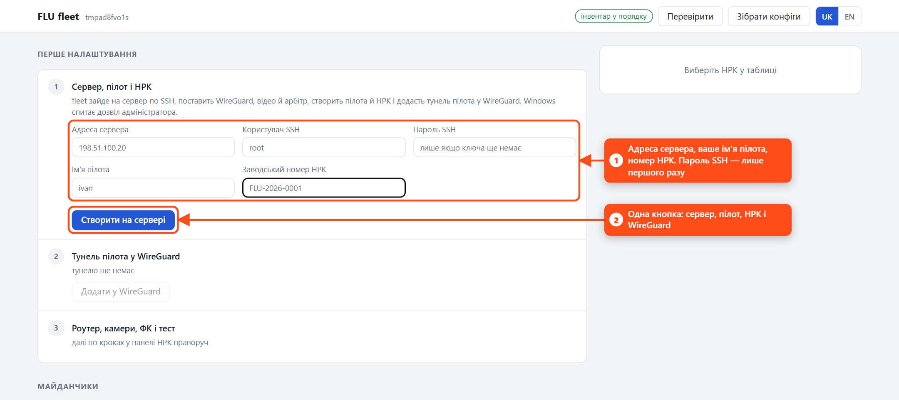

1. Заповніть:
   - **адресу сервера** (IP або DNS-ім'я; порт, якщо не 51820: `vpn.example.com:51900`);
   - **ім'я пілота** — це ви на цьому ноутбуці, латиницею (`ivan`);
   - **заводський номер НРК**.

   **Пароль SSH** потрібен лише першого разу: ним fleet один раз кладе на сервер ключ
   цього ноутбука (`~/.ssh/id_ed25519`) і ніде пароль не зберігає. Якщо на сервері вхід
   паролем вимкнено, майстер покаже відкритий ключ — додайте його в панелі хостингу.
2. Натисніть **«Створити на сервері»**. У консолі видно п'ять кроків:
   1. інвентар: адреса сервера, пілот і НРК записуються в `inventory/`;
   2. SSH-доступ до сервера за ключем;
   3. реєстрація НРК: слот, ключі в `secrets/`, конфіги в `build/robots/nrk-001/`;
   4. розгортання сервера: WireGuard, MediaMTX (відео) і арбітр (керування й панель пілотів);
   5. тунель пілота `main-<пілот>` у WireGuard — Windows спитає дозвіл адміністратора.

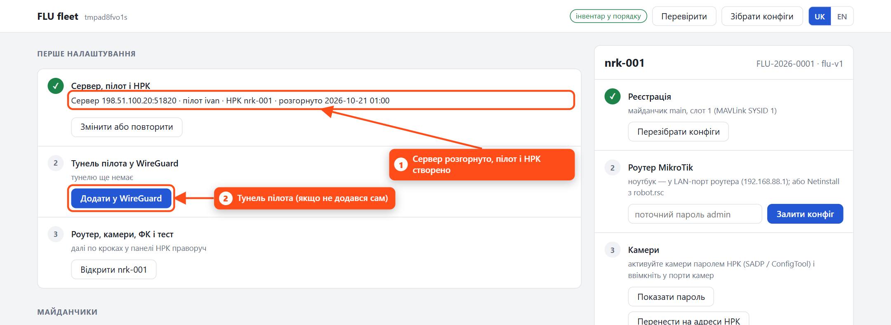

Ключ пілота створюється на ноутбуці й нікуди не передається: сервер отримує лише
відкритий ключ. Якщо тунель не додався (наприклад, ви відмовили в дозволі
адміністратора), натисніть **«Додати у WireGuard»**. Тунель `main-<пілот>` з'явиться в
застосунку WireGuard, а ноутбук опиниться в мережі майданчика: панель пілотів —
`http://10.150.0.1:8080`.

Коли тунель працює, майстер згортається в один рядок. Далі все — у панелі НРК праворуч:

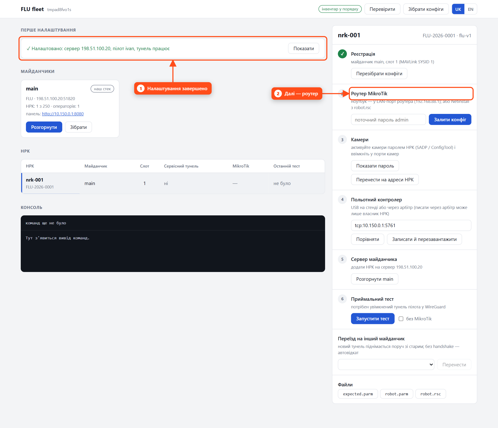

## 3. Роутер

Підключіть усе так:

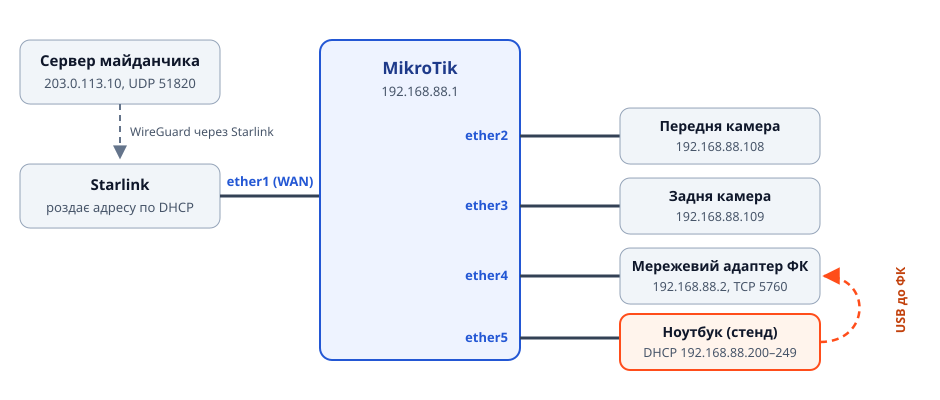

**Роутер із RouterOS (зазвичай так і є):** ноутбук — у будь-який LAN-порт роутера,
він видасть адресу з `192.168.88.x`.

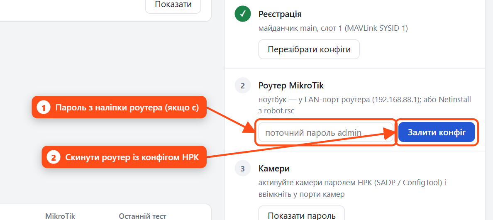

1. Введіть пароль `admin` із наліпки на роутері. На старих роутерах пароля немає, тоді поле лишіть порожнім.
2. Натисніть **«Залити конфіг»**. Роутер скинеться й перезавантажиться вже з конфігом НРК.
   fleet дочекається його, перевірить відбиток конфігу й збереже еталон для пошуку змін.
   Займає 1–3 хвилини.

**Через Netinstall** (роутер «цеглина», невідомий пароль або потрібна чиста RouterOS):
у Netinstall вкажіть як Configure script файл `robot.rsc`. Його можна відкрити в розділі «Файли»:

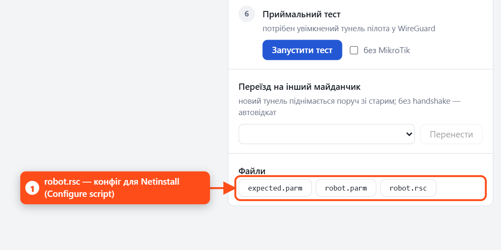

Після прошивки порти мають фіксоване призначення: `ether1` — Starlink, `ether2` — передня камера,
`ether3` — задня камера, `ether4` — адаптер ФК, `ether5` — ноутбук.

**Без кабелю, через Starlink.** Уже прошитий і зібраний НРК (Starlink у порту 1) можна перепрошити,
не розкручуючи його: під'єднайте ноутбук до Wi-Fi того самого Starlink і натисніть «Перевірити підключення».
Програма знайде роутер за ім'ям НРК (`nrk-003`) і сама підставить його пароль. З боку Starlink роутер
приймає лише ssh і лише з локальної мережі Starlink; камери, ФК і WinBox звідти закриті. Роутери,
прошиті до цієї версії, вперше перепрошиваються кабелем. Камери переносяться лише через кабель.

## 4. Камери

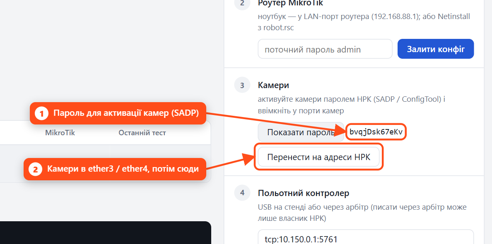

1. Натисніть «Показати пароль». Цим паролем активуйте обидві камери через SADP (Hikvision) або ConfigTool (Dahua).
2. Увімкніть передню камеру в `ether2`, задню — в `ether3` та натисніть **«Перенести на адреси НРК»**.

Обидві камери приходять із тією самою заводською адресою (`192.168.1.64`). Тому fleet
вимикає порт задньої камери, переносить передню на `192.168.88.108`, а потім задню — на `.109`.

## 5. Польотний контролер

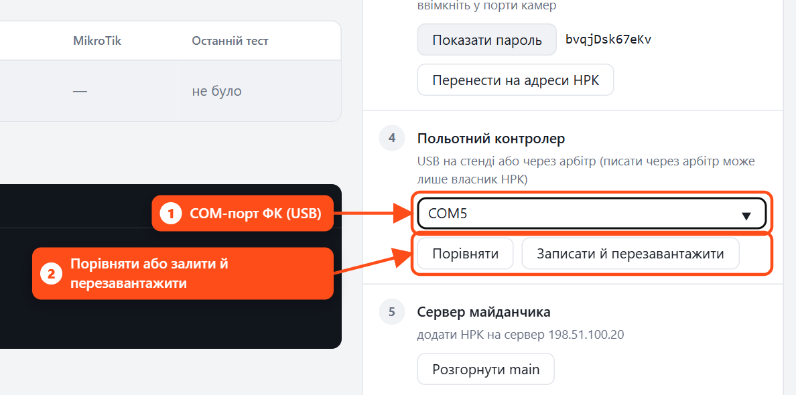

1. Підключіть ФК до ноутбука по USB і вкажіть COM-порт. Якщо порт видно в системі, він підставиться сам.
2. «Порівняти» показує, що відрізняється від еталона. **«Записати й перезавантажити»** записує
   SYSID, failsafe і канал MAVLink (а також базові параметри з `base/ardupilot-base.parm`, якщо ви їх туди поклали).

Мережевий адаптер ФК має працювати TCP-сервером на `192.168.88.2:5760`. Це налаштовується
один раз утилітою виробника адаптера.

## 6. Приймальний тест

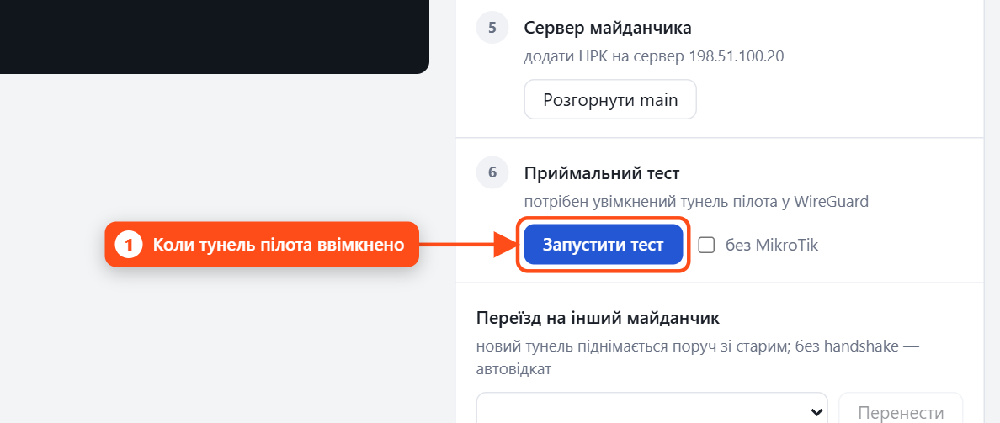

Тунель пілота має бути ввімкнений (крок 2). Натисніть **«Запустити тест»**. Тест перевіряє:
- арбітр бачить НРК, а MAVLink відповідає з правильним SYSID;
- параметри ФК збігаються з еталоном, зокрема failsafe;
- GPS і напругу батареї;
- обидві камери віддають відео через сервер;
- конфіг MikroTik не змінено і тунель живий (якщо зараз до роутера не дістатися, поставте позначку «без MikroTik»).

Результат з'являється одразу під кнопкою, а звіт зберігається в `build/reports/`.

## 7. Після цього

- **Закомітьте `inventory/`:** там тепер адреса сервера, пілот і слот НРК.
- **Збережіть `secrets/`:** без цієї теки обслуговувати НРК і сервер не вийде. Ключі не відновлюються.
- **Кілька пілотів на одному ноутбуці:** у кроці 1 виберіть пілота зі списку, щоб додати йому НРК,
  або «+ Новий пілот». У кожного пілота свій тунель `main-<пілот>`; вмикаючи один, програма
  вимикає інші. Файл тунелю для ноутбука пілота — кнопка «Файл тунелю для ноутбука пілота» в кроці 4.
- **Наступний НРК:** «Змінити або повторити» в майстрі, новий заводський номер — і знову кроки 3–6.
- **Інші пілоти:** додайте їх в `inventory/operators.yaml`, натисніть «Розгорнути» на картці
  майданчика й видайте кожному його конфіг з `build/sites/main/operators/`.

## Те саме з командного рядка

```powershell
.venv\Scripts\fleet setup --server 198.51.100.20 --pilot ivan --serial FLU-2026-0001 --ask-password
.venv\Scripts\fleet wg-install --pilot ivan
.venv\Scripts\fleet bench mikrotik --id 1 --password <з наліпки>
.venv\Scripts\fleet bench cameras --id 1
.venv\Scripts\fleet fc --id 1 --connect COM5 --push --reboot
.venv\Scripts\fleet test --id 1
```

## Мова

Інтерфейс перемикається між українською та англійською кнопками в шапці.
Вибір запам'ятовується в браузері.

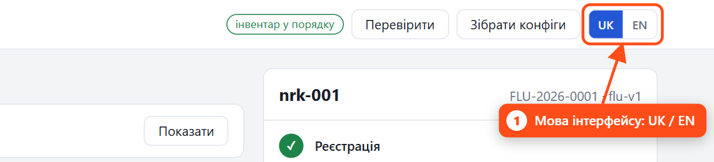

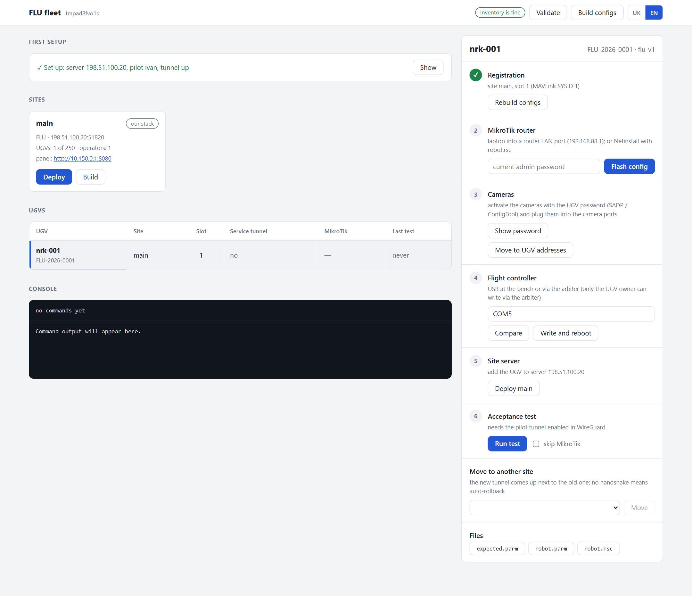

Вивід команди в консолі лишається мовою, якою її запускали. У терміналі мова задається
так: `fleet --lang en ...` або змінною `FLEET_LANG=en`.
